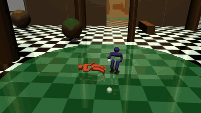
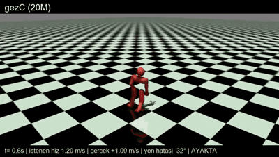
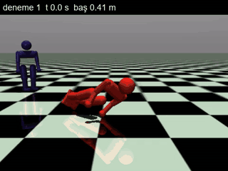

# Humanoid Fight RL

**Hierarchical reinforcement learning for physically simulated humanoid fighting in MuJoCo.**
Two 17-motor humanoid robots fight in a multi-zone arena. Nothing is scripted at the joint level: every motor
command comes from neural networks trained with PPO, and the robots get up on their own after they fall.

*Türkçe: [README.tr.md](README.tr.md)*

<p align="center">
  <br>
  <em>Robot vs robot: both sides are driven by the same tactic network (full video: <a href="media/match.mp4">media/match.mp4</a>)</em>
</p>

<p align="center">
  
  <br>
  <em>Left: walking at a commanded speed and heading. Right: getting up from the ground.</em>
</p>

## What it does

The tactic network picks a command every 0.26 s. Lower-level networks turn that command into joint targets at ~62 Hz.

```
                 ┌──────────────────────────────────────────┐
 opponent, map,  │  Tactic net (PPO, discrete, 47 → 9)       │  every 0.26 s:
 own state  ───▶ │  chase · slow chase · stop · turn L/R ·   │  which command?
                 │  punch · kick · flee · back off           │
                 └───────────────┬──────────────────────────┘
                                 │ command
               ┌─────────────────┼──────────────────────┐
               ▼                 ▼                      ▼
     ┌───────────────────┐ ┌──────────────────┐ ┌──────────────────┐
     │ Motion net        │ │ Walking net      │ │ Get-up expert    │
     │ (fight: approach, │ │ (opponent far:   │ │ (after a fall,   │
     │ face, strike)     │ │ speed + heading) │ │ until standing)  │
     └─────────┬─────────┘ └────────┬─────────┘ └────────┬─────────┘
               └─────── skill selector (rule-based) ─────┘
                                 │ 17 joint targets
                                 ▼
                   PD controller → MuJoCo physics (62.5 Hz control, 125 Hz physics)
```

- **Motion nets** are continuous-action PPO policies. They output PD targets for 17 motors and are trained
  with imitation rewards from retargeted human motion capture (punches, kicks, walking) plus task rewards
  (hit, stay upright, face the opponent).
- **Skill selector:** when the robot falls, the get-up expert takes over. When the opponent is far away, the
  walking net drives. Otherwise the fight motion net is in control.
- **Tactic net:** trained against a rule-based opponent and self-play snapshots, in a 4-zone arena
  (forest → wall breach → courtyard → temple).
- **Training:** parallel PPO on CPU workers, run on a 12-vCPU Google Cloud spot VM. Runs auto-resume after
  preemption and stop early when metrics stall.

## Results

All numbers come from local evaluation matches: the tactic net against the rule-based opponent, with fixed
seeds and identical conditions. Every candidate model was **chosen by matches, not by in-training metrics**
(see [docs/lessons.md](docs/lessons.md), lesson 21).

| System | Matches | Win | Score | Hits | Hits taken | Falls/match |
|---|---|---|---|---|---|---|
| Tactic net v5 | 24 | 100% | +123.7 | – | – | – |
| Tactic net v6 (new motion/get-up/walk nets) | 24 | 100% | +147.6 | – | – | – |
| v6, re-measured | 48 | 100% | +126.2 | 40.7 | 16.0 | 1.3 |
| **v6 + strike brake (current best)** | 48 | 96% | **+153.1** | **43.1** | **15.0** | **0.9** |

How the strike brake was found:
1. Every fall was logged and classified by what happened in the second before it. **52% of falls happened
   during the robot's own punch**, with no hit received, while moving at about 1.35 m/s.
2. A one-line rule was added: above 0.6 m/s, stop before striking.
3. Result: falls dropped by 30% and score rose by about 20%, with no retraining.

The details are in [docs/results.md](docs/results.md), including failed experiments such as a trained guard
stance that won fewer matches.

## Quick start

```bash
pip install -r requirements.txt          # Python 3.12
source scripts/best_system.sh            # physics settings + selected networks
bash scripts/evaluate.sh 24 2            # 24 matches on 2 workers -> win rate, score, hits, falls
bash scripts/record_match.sh media/my_match.mp4   # record a robot-vs-robot match
```

On Windows, run these commands in Git Bash. Training entry points: `sim/taktik_train.py` (tactic net) and
`sim/getup_train_par.py` (motion / get-up / walking nets; the skill is chosen with `BECERI=...`). Example
commands are in [docs/architecture.md](docs/architecture.md).

## Repository layout

```
sim/                    simulation, environments, training (run from this folder)
  taktik_env.py         match environment: arena zones, command execution, strike brake
  taktik_train.py       tactic net (PPO, discrete)
  dovus_mac_env.py      two-robot fight physics, contacts, damage, falls
  alt_dovus_env.py      motion-net training env (strike/approach/guard rewards)
  getup_train_par.py    parallel PPO trainer for continuous skills
  gezinme.py            path following for walking commands
  dovus_kayit.py        match recorder (MP4)
  degerlendirme/        evaluation (taktik_olc.py: N-match benchmark)
  models/               the four selected networks (~33 MB)
  referanslar/          retargeted motion-capture references (see DATA_SOURCES.md)
  arena/                arena physics model (4 zones)
docs/                   architecture, results, lessons learned
scripts/                best-system settings, evaluation, recording
media/                  GIFs and video
```

Identifiers and comments in the code are in **Turkish**. For example, `taktik` = tactic, `alt` = lower-level
motion net, `kalkis` = get-up, `gez` = walk/navigate, `isabet` = hit, `düşme` = fall.

## Lessons learned

The project keeps a log of 24 lessons. Each one records a failure, its root cause and the rule that came out
of it. A selection is in [docs/lessons.md](docs/lessons.md). For example: flat exponential reward kernels give
no gradient far from the target, the best checkpoint of a long run is often not the last one, and
in-training gains can disappear in real matches.

## Limitations

- **Simulation only.** No sim-to-real transfer has been attempted, and there is no hardware.
- **Narrow evaluation.** The opponent in evaluation matches is rule-based. The 24- and 48-match benchmarks
  have about ±15% run-to-run variance, so small differences are not meaningful.
- **No baselines.** There is no comparison against published methods.

## Credits

Built by **Ahmet Selim K.**, with AI pair-programming assistance (Claude). Motion references are derived from
the CMU Graphics Lab Motion Capture Database and the Bandai Namco Research Motiondataset-1 (CC BY-NC 4.0);
see `sim/referanslar/DATA_SOURCES.md`. The code is MIT-licensed; the motion data keeps its original terms.
