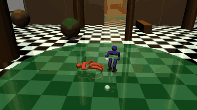

# Humanoid Fight RL

**MuJoCo'da fiziksel simülasyonla dövüşen insansı robotlar için hiyerarşik pekiştirmeli öğrenme.**

İki insansı robot (her biri 17 motorlu) çok bölgeli bir arenada dövüşüyor. Eklem düzeyinde elle yazılmış hareket yok:
her motor komutu PPO ile eğitilmiş sinir ağlarından geliyor. Robotlar düşünce kendi başlarına kalkıyor.

*English: [README.md](README.md)*

<p align="center">
  <br>
  <em>İki robotu da aynı taktik ağı yönetiyor. Tam video: <a href="media/match.mp4">media/match.mp4</a></em>
</p>

## Nasıl çalışıyor

Sistem üç katmandan oluşuyor:

- **Taktik ağı:** Ayrık eylemli PPO ağı. 0.26 saniyede bir 9 komuttan birini seçer: kovala, yavaş kovala, dur,
  sola dön, sağa dön, yumruk, tekme, kaç, geri çekil.
- **Hareket ağları:** Sürekli eylemli PPO ağları. Komutu ~62 Hz'de 17 motorun PD hedeflerine çevirirler. Üç ağ var:
  - **Dövüş hareketi:** yaklaşma, rakibe dönme ve vuruş.
  - **Yürüme:** istenen hız ve yönde yürüme.
  - **Kalkış uzmanı:** düşünce robotu ayağa kaldırır.
- **Beceri seçici (kural tabanlı):** Robot düştüyse kalkış uzmanını, rakip uzaktaysa yürüme ağını, diğer durumlarda
  dövüş ağını devreye sokar.

**Ödüller:** Hareket ağları, insan hareket yakalama verisinden robota aktarılan referanslarla eğitildi (yumruk, tekme ve
yürüme taklidi). Bunlara görev ödülleri eklendi: isabet, ayakta kalma, rakibe dönük olma.

**Eğitim altyapısı:** Eğitimler 12 çekirdekli bir Google Cloud spot makinesinde koştu. İzleme sistemi:
- makine kesilirse eğitimi kaldığı yerden sürdürür;
- ilerleme durunca eğitimi erken durdurur;
- eğitim bitince kayıtları indirip makineyi kapatır.

## Sonuçlar

Tüm sayılar sabit tohumlu yerel maçlardan geliyor: taktik ağı, kural tabanlı rakibe karşı oynuyor.
Ayrıntılar: [docs/results.md](docs/results.md).

| Sistem | Maç | Kazanma | Skor | İsabet | Alınan | Düşme/maç |
|---|---|---|---|---|---|---|
| Taktik v6 | 48 | %100 | +126.2 | 40.7 | 16.0 | 1.3 |
| **Taktik v6 + vuruş freni (en iyi)** | 48 | %96 | **+153.1** | **43.1** | **15.0** | **0.9** |

Vuruş freni şöyle bulundu:

1. Her düşmenin öncesindeki 1 saniye kaydedilip sınıflandırıldı. Düşmelerin **%52'si robotun kendi yumruğu
   sırasında** gerçekleşmişti; robot darbe almamıştı ve ~1.35 m/s hızla ilerliyordu.
2. Tek satırlık bir kural eklendi: "0.6 m/s üstündeyken vurmadan önce dur".
3. Bu kural düşmeyi %30 azalttı, skoru ~%21 artırdı. Yeniden eğitim gerekmedi.

**Başarısız denemeler de belgelendi.** Örneğin gard duruşu eğitim ortamında isabeti ikiye katladı, ama maçlarda
kaybettirdi.

## Hızlı başlangıç

```bash
pip install -r requirements.txt          # Python 3.12
bash scripts/evaluate.sh 24 2            # 24 maç, 2 işçi
bash scripts/record_match.sh media/mac.mp4
```

Windows'ta komutları Git Bash ile çalıştırın.

## Çıkarılan dersler

Proje boyunca 24 ders kaydedildi. Her biri bir başarısızlığı, kök nedenini ve bundan çıkan kuralı anlatıyor.
Seçmeler: [docs/lessons.md](docs/lessons.md).

## Sınırlar

- **Yalnız simülasyon:** Gerçek donanım yok, simülasyondan gerçeğe aktarım denenmedi.
- **Değerlendirme:** Değerlendirme rakibi kural tabanlı. 24 maçlık ölçümlerde sonuçlar ~±%15 oynayabiliyor.
- **Kıyas yok:** Yayımlanmış yöntemlerle karşılaştırma yapılmadı.

## Emeği geçenler

Geliştiren: **Ahmet Selim K.**, yapay zekâ destekli eşli programlama (Claude) ile.

Hareket referansları CMU Graphics Lab Motion Capture Database ve Bandai Namco Research Motiondataset-1'den
(CC BY-NC 4.0) türetildi. Kod MIT lisanslı; hareket verisi kendi lisans koşullarına tabi.
